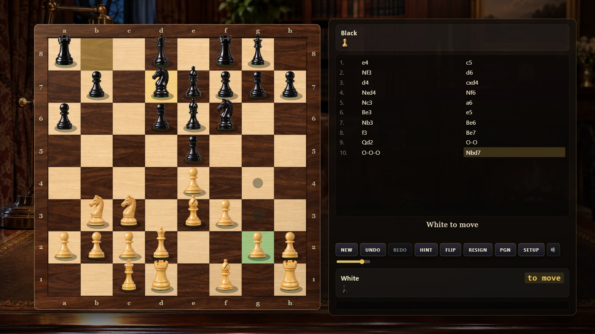
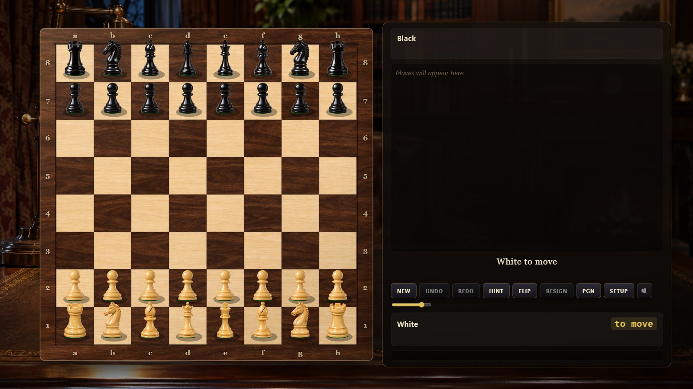
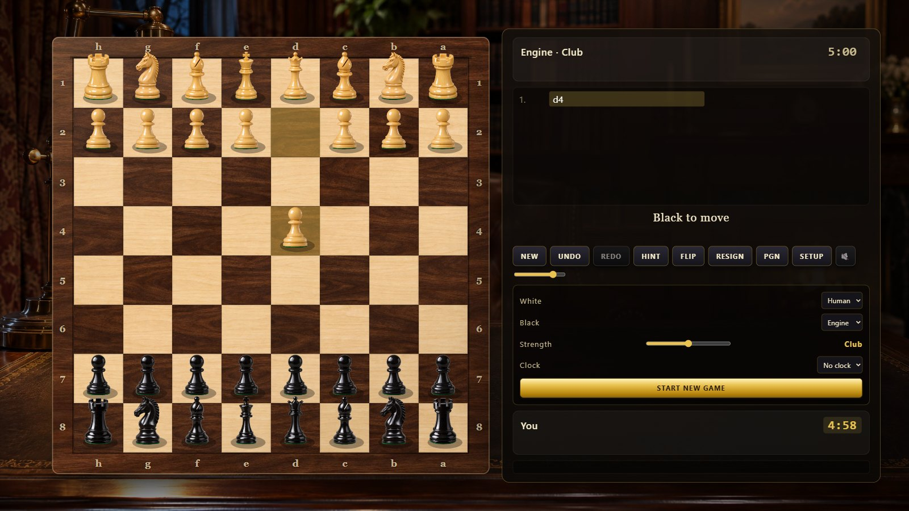
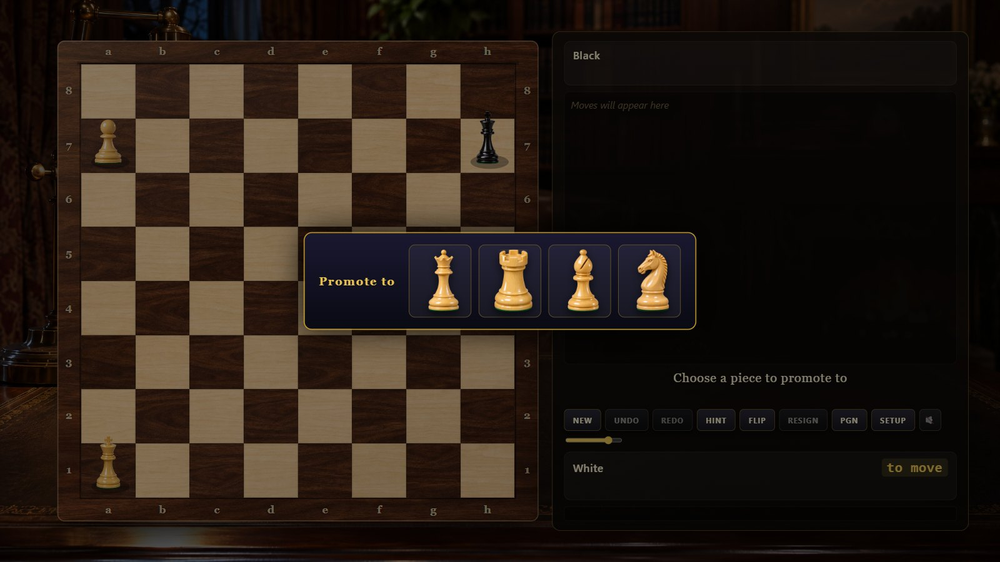
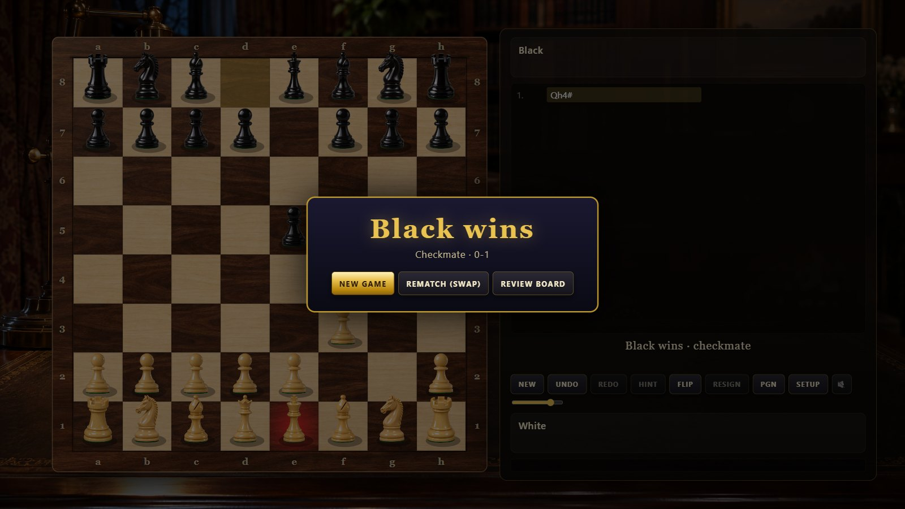

<div align="center">

# ♔ GRAND CHESS

### Complete chess in the browser: photoreal Staunton set, physical animation, synthesized sound and an alpha-beta engine in a Web Worker




</div>

Plain HTML5 Canvas and vanilla JavaScript, no frameworks, no build step. Every
rule of chess, a move generator verified against the standard perft counts, an
engine with five strengths that never blocks the board, PGN and FEN in and out,
clocks, hints, undo and redo.

---

## Contents

1. [Features](#features)
2. [Platforms](#platforms)
3. [Installation](#installation)
4. [Configuration reference](#configuration-reference)
5. [User guide](#user-guide)
6. [Keyboard shortcuts](#keyboard-shortcuts)
7. [Known limitations](#known-limitations)
8. [Project layout](#project-layout)
9. [Development](#development)

---

## Features

**Rules**

* Legal move generation with castling (rights tracked per rook and king, squares
  checked for attack), en passant, promotion with a choice dialog
* Check, checkmate, stalemate, fifty-move rule, threefold repetition,
  insufficient material; resignation and clock flag falls
* SAN with disambiguation, UCI, FEN load/display, PGN export with headers and
  PGN import (comments, variations and NAGs are skipped)

**Engine (`js/engine.js`, run in `js/worker.js`)**

* Iterative deepening alpha-beta with principal-variation search, quiescence
  search with delta pruning, a 1M-entry transposition table, killer moves and
  history heuristic, null-move pruning, late-move reductions, check extension
  and mate-distance pruning
* Tapered middlegame/endgame piece-square evaluation with bishop pair, doubled,
  isolated and passed pawns, open files for rooks and a king pawn shield
* Five levels: Beginner (depth 1, noisy), Casual (depth 2), Club (depth 4),
  Strong (depth 6, 1.8 s), Master (up to depth 14, 4 s); about 0.8–1.0 million
  nodes per second in Node; a small opening book gives variety in the first moves
* Hint: a one-second search drawn as an arrow

**Presentation**

* Walnut-and-maple board built from generated wood textures, walnut frame with
  engraved coordinates, varnish sheen; twelve transparent photoreal Staunton
  renders with vector fallbacks
* Pieces slide with a lift and soft shadow, captures knock the taken piece off
  the board, castling animates both pieces, promotion morphs the pawn; last
  move, selection, legal targets, hover, check glow and hint arrow highlights
* Click-click or drag-and-drop input, board flip (automatic when you play Black)
* Side panel with players, clocks, captured material and material balance,
  SAN move list, status, engine depth/eval, settings, PGN/FEN box
* Sounds synthesized in Web Audio: wooden set-downs that vary by piece, capture
  thuds, castling double tap, check and promotion chimes, clock ticks and
  low-time alarm, game-over tones, a fireplace crackle bed

---

## Platforms

| Platform | Status | Notes |
| --- | --- | --- |
| Chrome / Edge (desktop) | Tested | Headless Chrome runs the smoke test and screenshots |
| Firefox / Safari | Expected to work | Canvas 2D, Web Audio, Web Worker only |
| Tablets / phones | Playable | Pointer events, scene scales to the screen; landscape recommended |
| `file://` | Works | Workers are blocked from disk, so the engine then runs on the main thread (brief pauses at high levels) |

Requirements: a browser with Canvas 2D, Web Audio and ES2020. Node.js 22+ for
the optional tools.

---

## Installation

1. **Get the files.** Keep `assets/`, `css/` and `js/` next to `index.html`.
2. **Serve it (recommended, enables the worker engine):**

   ```bash
   python -m http.server 8769
   ```

   or double-click `start.cmd` on Windows, then open <http://localhost:8769/>.
3. **Or open `index.html` directly** from disk.
4. **Click once** on the splash to start; the default game is you as White
   against the Club-level engine.
5. Optional URL parameters: `?white=ai&black=human`, `?level=5`, `?clock=5+0`,
   `?fen=<FEN>` (URL-encoded), `?mute=1`.

### Configuration reference

| Setting | File | Default | Meaning |
| --- | --- | --- | --- |
| `LEVELS` | `js/engine.js` | 5 entries | Depth, time budget (ms) and evaluation noise per strength level |
| `BOOK` | `js/engine.js` | 15 lines | Opening book: UCI move lists keyed by the moves so far |
| `VAL`, `PST_MG`, `PST_EG`, `PASSED` | `js/engine.js` | material 100/320/330/500/900 | Evaluation terms |
| `TT_SIZE` | `js/engine.js` | `1 << 20` | Transposition table entries |
| `CLOCKS` | `js/game.js` | none, 1+0 … 30+0 | Time controls offered in Settings |
| `BOARD`, `FRAME` | `js/renderer.js` | 104 px squares, 46 px frame | Board geometry in the 1920 × 1080 scene |
| `HEIGHT` | `js/assets.js` | K 1.0 … P 0.68 | Relative piece heights of the set |
| animation durations | `js/game.js` `applyMove` | 0.24–0.32 s | Slide time for human/engine moves |
| `chess.volume`, `chess.muted` | browser `localStorage` | `0.8`, `0` | Remembered sound settings |

---

## User guide

### The board



Click a piece to see its legal moves (dots for quiet moves, rings for captures)
and click a destination, or drag the piece. The last move is tinted, the side
panel shows whose turn it is, and the checked king glows.


### Playing the engine

Open **SETUP** to choose who plays each colour, the engine strength and a clock,
then **START NEW GAME**. The engine thinks in a Web Worker; the panel shows its
search depth and evaluation. **HINT** draws the engine's suggestion for your
side. **UNDO** takes back your last move together with the engine's reply;
**REDO** replays it.



### Promotion, check and game end



A pawn reaching the last rank opens the promotion dialog. Check is announced
with a chime and a glow; checkmate, stalemate, repetition, the fifty-move rule,
insufficient material, resignation and flag falls end the game with an overlay
offering a new game, a rematch with colours swapped or a look at the final board.



### PGN and FEN

**PGN** opens a box with the game in PGN (copy it, or paste a PGN and **LOAD
PGN**; paste a FEN and **LOAD FEN** to set up a position). The current FEN is
always shown under the panel.

---

## Keyboard shortcuts

| Key | Action |
| --- | --- |
| `N` | New game with the current settings |
| `U` / `←` | Undo |
| `R` / `→` | Redo |
| `H` | Hint |
| `F` | Flip the board |
| `M` | Mute / unmute |
| `Esc` | Clear selection, close dialogs |

---

## Known limitations

* The engine is a compact JavaScript searcher, strong club level at best; it
  has no endgame tablebases and its opening book is tiny.
* PGN import ignores comments, variations and annotations; only mainline moves
  are replayed.
* From `file://` the engine runs on the main thread and the board can pause for
  a second or two at the Strong and Master levels.
* Games are not saved between visits (export the PGN to keep one).
* No online play; two players share one board.

---

## Project layout

```
chess/
├── index.html            page: canvas, side panel, dialogs, splash
├── start.cmd             Windows launcher (local server + browser)
├── css/style.css         panel, buttons, dialogs
├── js/
│   ├── chess.js          rules: 0x88 board, legal moves, make/unmake, FEN, SAN, PGN, status, perft
│   ├── engine.js         evaluation + alpha-beta search, levels, opening book
│   ├── worker.js         Web Worker wrapper for the engine
│   ├── audio.js          shared Web Audio synthesizer engine
│   ├── audio-chess.js    piece, check, promotion, clock and game-over sounds
│   ├── assets.js         piece renders, textures, vector fallbacks
│   ├── renderer.js       board, highlights, pieces, animations, hint arrow
│   ├── game.js           game controller: modes, worker, undo/redo, clocks, PGN/FEN
│   ├── ui.js             DOM panel, dialogs, pointer and keyboard input
│   └── main.js           bootstrap, frame loop, test hooks
├── assets/
│   ├── pieces/*.png      12 transparent Staunton renders
│   ├── board/*.jpg       maple and walnut textures
│   └── bg/study.jpg      study backdrop
├── docs/
│   ├── index.html        GitHub Pages landing page
│   └── screenshots/      images used here and on the landing page
└── tools/
    ├── perft.js          move-generator verification (5 reference positions)
    ├── engine-test.js    forced-mate puzzles, speed probe, SAN/PGN round trips
    ├── cdp.mjs           shared headless-Chrome helper (no dependencies)
    ├── smoke.mjs         17-check headless UI test incl. real mouse input
    ├── screenshots.mjs   documentation screenshots
    └── pngalpha.py       alpha-channel report for PNG assets
```

---

## Development

**Verify the rules:**

```bash
node tools/perft.js
```

prints the node counts for the start position (20 / 400 / 8,902 / 197,281),
Kiwipete (48 / 2,039 / 97,862), position 3 (14 / 191 / 2,812 / 43,238) and two
more reference positions; all must match.

**Test the engine:** `node tools/engine-test.js` solves forced mates, probes
speed from the start position and round-trips SAN and PGN.

**Headless UI test:** `node tools/smoke.mjs` launches headless Chrome or Edge,
plays scripted games through the UI layer (castling, en passant, promotion
dialog, undo/redo, PGN, draws, mate overlay), waits for a worker engine reply,
clicks and drags pieces with real mouse events, lets a clock run out and fails
on any console error. `node tools/screenshots.mjs` regenerates `docs/screenshots/`.

**Test hooks in the console:** `CHESS_APP.game.playSan('e4')`,
`CHESS_APP.game.state()`, `CHESS_APP.step(seconds)` advances animations and
clocks deterministically.

**Publish:** enable GitHub Pages for the repository root; the game is served at
`/` and the landing page at `/docs/`.
